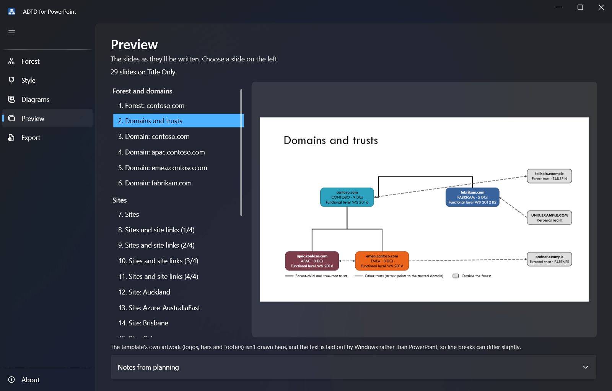
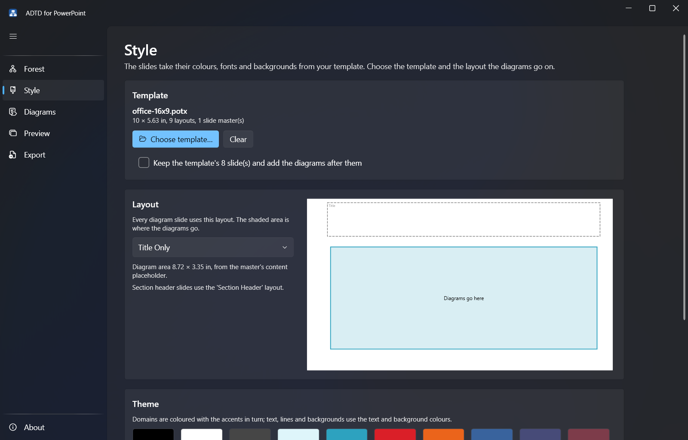

# ADTD for PowerPoint

Draws your Active Directory forest as native, editable PowerPoint slides in your own template: the domains and
trusts, the sites and site links, and every domain controller with its roles, addresses and subnets.

It is a rebuild, for PowerPoint, of [ADTD.Net](NOTICE.md) by Goran Mihelcic. The LDAP queries and the site map's
geometry are ported from it; instead of a Visio drawing it writes a .pptx that takes its colours, fonts, slide size
and layout from a template you choose.



## What you get

A deck in two PowerPoint sections:

- **Forest, domains and trusts:** a section header; a summary of the forest; the domains and trusts (a tree per domain tree, with shortcut,
  external, forest and realm trusts and their directions); and a slide per domain, its DCs grouped by site.
- **Sites:** a section header; the sites and site links, laid out with ADTD.Net's own geometry, each link labelled
  with its name, cost and interval; and a slide per site with its DCs and subnets. When the sites need more than one
  slide, a dashed "+n more sites" placeholder on each slide says which other slides the missing sites are on.
  Optionally, empty sites that hang off the same site are consolidated into one box (ADTD.Net's "Aggregate empty
  sites").

Everything is a real PowerPoint shape: boxes, glued connectors, tables and the DC icon (SVG, with a PNG fallback).
Colours are theme colours and fonts are theme fonts, so the slides follow the template, and you can edit them
like any other slide. What doesn't fit at a legible size goes onto further slides rather than shrinking.

## Install

1. Download `ADTD-for-PowerPoint-<version>.zip` from the
   [latest release](https://github.com/MrR1974/ADTD-for-PowerPoint/releases/latest) and extract it.
2. Double-click **Install ADTD for PowerPoint.cmd**.

It installs for you only, with no administrator rights, into `%LOCALAPPDATA%\Programs\ADTD for PowerPoint`, adds
a Start menu shortcut and lists the app in **Settings > Apps**, where you can uninstall it. The .NET runtime is
included. To use the `adtd` command in any terminal as well, run `Install-Adtd.ps1 -AddToPath` from PowerShell.

PowerPoint isn't needed to make the slides, only to open them.

## Use



1. **Forest:** collect from Active Directory (the computer's own domain is filled in; use other credentials if you
   need to), or open a snapshot collected earlier, or try one of the sample forests. Save the snapshot to keep it.
2. **Style:** choose your template (.potx or .pptx) and the layout the diagrams go on. The wireframe shades the
   area the diagrams get; the theme's colours and fonts are shown below it. Choose a different DC icon if you like.
3. **Diagrams:** choose which slides to make and what goes on them.
4. **Preview:** look through the slides before you write them.
5. **Export:** save the deck, and open it in PowerPoint.

Settings, including the last template and forest, are remembered between runs. Passwords never are.

### Collecting from somewhere else

If the forest can't be reached from your computer, collect it on a machine inside the domain with the
command-line tool and bring the snapshot back: see [Collecting a forest offline](docs/Collecting.md). Any domain
user can read everything that's collected, nothing is written to the directory, and the run leaves a log of every
query to help diagnose problems.

## Command line

`adtd.exe` is installed alongside the app.

| Command | Does |
|---|---|
| `adtd collect [--server <dc-or-domain>] [--user DOMAIN\name] [--out forest.json]` | Reads the forest and saves a snapshot and a log |
| `adtd info forest.json` | Summarises a snapshot |
| `adtd sample <name>` | Writes a made-up forest, for trying things out: `single`, `contoso`, `hub`, `satellites`, `regional`, `spokes`, `large` |
| `adtd template <file.potx>` | Lists a template's layouts and where the diagrams would go on each |
| `adtd render forest.json --template <file.potx> [--layout <name>] [--out deck.pptx]` | Makes the deck (see `adtd --help` for every option) |

## Build from source

Needs the .NET 8 SDK on Windows.

```powershell
dotnet build Adtd.sln
dotnet test Adtd.sln
dotnet run --project src\Adtd.App            # the app
.\tools\New-Package.ps1 -Version 1.0.0       # the release zip, in dist\
```

| Project | What it is |
|---|---|
| `Adtd.Model` | The forest snapshot and its JSON form; the sample forests |
| `Adtd.Collect` | Reading a forest over LDAP (System.DirectoryServices.Protocols) |
| `Adtd.Layout` | Planning the slides: sizes, layouts (including the WebLayout port), pagination, colours |
| `Adtd.Imaging` | The DC icon and measuring text in the theme fonts (SkiaSharp) |
| `Adtd.PowerPoint` | Reading templates and writing the deck (Open XML SDK) |
| `Adtd.Cli` | `adtd` |
| `Adtd.App` | The desktop app (WPF, WPF-UI) |

Tools: `tools\Render-Samples.ps1` renders every sample forest on every test template and exports the slides as
images through PowerPoint, for checking layout changes by eye; `tools\New-TestTemplates.ps1` builds those test
templates from Office's own; `tools\Publish-Collector.ps1` builds `adtd.exe` as a single file to carry to a
domain-joined machine; `tools\New-Icon.ps1` draws the app icon.

## Templates

No PowerPoint template ships with ADTD for PowerPoint: you bring your own .potx, .pptx or .thmx, and the slides take
its layouts, theme colours and fonts. Templates used in development stay in `samples/local/`, which git ignores, and
`tools\New-Package.ps1` refuses to build a release that contains a template or anything from `samples/local/`.

## Licence

ADTD for PowerPoint is published under the [MIT License](LICENSE).

## Credits

ADTD for PowerPoint is a rebuild of ADTD.Net by Goran Mihelcic, which is published under the MIT License. Its LDAP
queries, trust decoding and WebLayout site-map geometry are ported from ADTD.Net's source. ADTD.Net's licence notice
and the third-party components are in [NOTICE.md](NOTICE.md).
